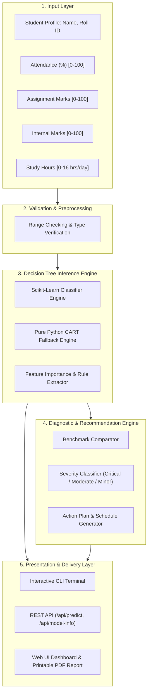
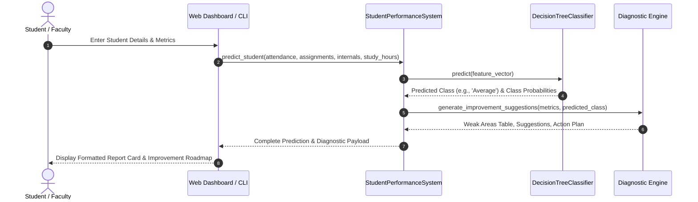

# Intelligent Student Performance Prediction System
## Comprehensive University Project Report & Technical Documentation

---

### Project Metadata
- **Project Title:** Intelligent Student Performance Prediction System Using Machine Learning Classification and Decision Trees
- **Domain:** Artificial Intelligence, Machine Learning, Educational Data Mining (EDM)
- **Target Audience:** Academic Evaluators, University Examination Boards, Faculty Mentors, and Students
- **Repository:** [https://github.com/etherialspace/student-performance-prediction](https://github.com/etherialspace/student-performance-prediction)

---

## 1. Abstract

Timely identification of student academic risk is critical for educational institutions to provide targeted pedagogical interventions prior to high-stakes examinations. This project presents the design, mathematical formulation, and implementation of an **Intelligent Student Performance Prediction System**. 

The system leverages a **Supervised Machine Learning Classification** approach based on a **Decision Tree Classifier (CART algorithm using Gini Impurity)** to categorize student academic trajectories into four discrete performance tiers: **Excellent**, **Good**, **Average**, and **Poor**. Predictions are computed from four core academic parameters:
1. **Attendance Percentage (%)**
2. **Assignment Marks (out of 100)**
3. **Internal Examination Marks (out of 100)**
4. **Daily Self-Study Hours (hrs/day)**

Beyond classification, the system incorporates an **Advanced Diagnostic Improvement Engine** that evaluates student parameters against empirical institutional benchmarks, identifies deficient areas, ranks them by priority severity (*Critical*, *Moderate*, *Minor*), and automatically compiles an individualized, actionable academic remediation plan. The system is delivered with a dual-engine architecture (a production `scikit-learn` model and a zero-dependency pure Python CART fallback), a command-line interface (CLI), an automated unit test suite, and an interactive real-time web dashboard.

---

## 2. Introduction & Problem Statement

### 2.1 Background & Motivation
In contemporary higher education, cumulative end-of-term examinations often represent the primary assessment metric. However, relying solely on final outcomes provides post-facto diagnosis when course remediation is no longer feasible. Educational institutions collect continuous academic touchpoints—such as daily attendance records, periodic assignment submissions, internal test scores, and self-reported study habits. Applying Machine Learning techniques to these features enables proactive academic advisory systems that identify at-risk students weeks in advance.

### 2.2 Problem Statement
Given an input feature vector \(\mathbf{x} = [x_1, x_2, x_3, x_4]^T\) representing a student's continuous academic indicators:
- \(x_1 \in [0, 100]\): Attendance percentage
- \(x_2 \in [0, 100]\): Assignment score
- \(x_3 \in [0, 100]\): Internal examination marks
- \(x_4 \in [0, 16]\): Daily self-study duration in hours

Develop a supervised classification model \(f: \mathbb{R}^4 \to \mathcal{Y}\) that maps \(\mathbf{x}\) to a target performance tier:
$$\mathcal{Y} = \{\text{Excellent}, \text{Good}, \text{Average}, \text{Poor}\}$$

Furthermore, synthesize a diagnostic mapping \(g(\mathbf{x}, \hat{y}) \to (\mathcal{W}, \mathcal{S}, \mathcal{A})\), where \(\mathcal{W}\) is a set of parameter-specific deficiencies, \(\mathcal{S}\) is a set of explanatory improvement suggestions, and \(\mathcal{A}\) is a prioritized corrective action plan.

### 2.3 Project Objectives
1. **Academic Data Intake:** Formulate robust input validation ensuring physical bounds and type consistency for all student parameters.
2. **ML Classification Induction:** Construct and train a Decision Tree model with high predictive accuracy and interpretability.
3. **White-Box Explainability:** Provide transparent inspection of tree splitting nodes, decision boundaries, and feature importance rankings.
4. **Diagnostic Intervention (Advanced Feature):** Quantify academic deficiencies against performance benchmarks with severity categorization.
5. **Multi-Interface Deployment:** Expose the model through an interactive terminal interface, a REST API, and a browser-based dashboard.

---

## 3. Theoretical Background & AI Concepts

### 3.1 Supervised Learning & Classification
Supervised classification learns a mapping function from labeled training tuples \(\mathcal{D} = \{(\mathbf{x}_i, y_i)\}_{i=1}^N\). Unlike regression, which predicts a continuous quantity, classification partitions the feature space into decision regions corresponding to mutually exclusive categorical classes.

### 3.2 Decision Tree Classifier (CART)
A **Decision Tree** is a non-parametric supervised learning algorithm that recursively partitions the feature space using orthogonal hyperplanes. Decision trees were chosen for this system due to several key institutional advantages:
- **Interpretability ("White-Box"):** Faculty, counselors, and students can trace the exact logical chain leading to a classification (e.g., `IF Study_Hours <= 4.2 AND Internal_Marks <= 49.0 THEN Poor`).
- **Scale Invariance:** Normalization or standardization of features is not mandatory; study hours (\(0-16\)) and percentage marks (\(0-100\)) can be split without distortion.
- **Non-Linear Decision Boundaries:** Capable of capturing threshold effects (e.g., mandatory \(75\%\) attendance threshold).

#### Mathematical Splitting Criterion: Gini Impurity
For a dataset node \(D\) containing samples from \(K = 4\) classes with class probabilities \(p_k\), the **Gini Impurity** \(I_G(D)\) is defined as:
$$I_G(D) = 1 - \sum_{k=1}^K p_k^2$$

When a candidate split on feature \(j\) at threshold \(\theta\) partitions \(D\) into subsets \(D_L\) and \(D_R\), the **Gini Impurity of the Split** is the weighted average:
$$I_G(D, j, \theta) = \frac{|D_L|}{|D|} I_G(D_L) + \frac{|D_R|}{|D|} I_G(D_R)$$

The algorithm selects the feature \(j^*\) and threshold \(\theta^*\) that maximize the **Gini Information Gain** \(\Delta I_G\):
$$\Delta I_G = I_G(D) - I_G(D, j, \theta)$$

```
Optimal Split: (j*, θ*) = argmax [ IG(D) - ( |DL|/|D| * IG(DL) + |DR|/|D| * IG(DR) ) ]
```

#### Feature Importance Computation
The total importance \(M_j\) of feature \(j\) is calculated as the sum over all internal nodes \(t\) split on feature \(j\), normalized by the total impurity reduction across the tree:
$$M_j = \sum_{t \in T, \text{feat}(t) = j} \frac{N_t}{N} \Delta I_G(t)$$
$$\tilde{M}_j = \frac{M_j}{\sum_{k} M_k}$$

---

## 4. System Architecture & Design

### 4.1 Architectural Block Diagram



### 4.2 Execution Sequence



---

## 5. Implementation Details

### 5.1 Dataset Schema & Curation
A curated dataset of 56 diverse student records (`student_dataset.csv`) was synthesized to represent standard academic performance clusters:

| Feature Name | Type | Range | Description |
| :--- | :--- | :--- | :--- |
| `Attendance` | Float | `0.0 - 100.0%` | Classroom lecture and lab attendance |
| `Assignment_Marks` | Float | `0.0 - 100.0` | Continuous evaluation problem sets & projects |
| `Internal_Marks` | Float | `0.0 - 100.0` | Mid-semester and continuous assessment exams |
| `Study_Hours` | Float | `0.0 - 16.0` | Dedicated independent study time per day |
| `Performance` | Target Class | 4 Classes | Target label (`Excellent`, `Good`, `Average`, `Poor`) |

#### Class Distribution
- **Excellent (14 samples, 25%):** High consistency across all metrics (Attendance \(\ge 85\%\), Marks \(\ge 85\), Study Hours \(\ge 7.0\)).
- **Good (14 samples, 25%):** Solid metrics with occasional moderate indicators (Attendance \(\ge 75\%\), Marks \(70-85\), Study Hours \(4.5-6.5\)).
- **Average (14 samples, 25%):** Moderate metrics with visible gaps (Attendance \(60-75\%\), Marks \(55-70\), Study Hours \(2.8-4.5\)).
- **Poor (14 samples, 25%):** Critical metrics needing immediate intervention (Attendance \(< 60\%\), Marks \(< 50\), Study Hours \(< 2.5\)).

### 5.2 Dual-Engine Model Architecture
To guarantee maximum portability in varied university computing laboratories, the project implements a resilient dual-engine pattern:
1. **Primary Engine (`scikit-learn`):** Employs `sklearn.tree.DecisionTreeClassifier(criterion='gini', max_depth=4, random_state=42)` and `export_text`.
2. **Fallback Engine (`FallbackDecisionTreeClassifier`):** A custom, object-oriented CART implementation written strictly in standard Python (no external C-extensions). It implements recursive tree growth, Gini split finding, probabilistic prediction, feature importance calculation, and textual rule export.

```python
# Recursive split optimization snippet from FallbackDecisionTreeClassifier
def _best_split(self, X: List[List[float]], y: List[str]):
    n = len(y)
    parent_gini = self._gini(y)
    best_gain, best_feat, best_thresh = 0.0, None, None
    for feat_idx in range(len(X[0])):
        values = sorted(set(row[feat_idx] for row in X))
        thresholds = [(values[i] + values[i + 1]) / 2.0 for i in range(len(values) - 1)]
        for thresh in thresholds:
            left_y = [y[i] for i in range(n) if X[i][feat_idx] <= thresh]
            right_y = [y[i] for i in range(n) if X[i][feat_idx] > thresh]
            if not left_y or not right_y:
                continue
            weighted_gini = (len(left_y)/n * self._gini(left_y)) + (len(right_y)/n * self._gini(right_y))
            gain = parent_gini - weighted_gini
            if gain > best_gain:
                best_gain, best_feat, best_thresh = gain, feat_idx, thresh
    return best_feat, best_thresh, best_gain
```

### 5.3 Advanced Feature: Diagnostic Improvement Engine
The diagnostic module executes parameter-by-parameter gap analysis against institutional target benchmarks:

```
Institutional Target Benchmarks:
  • Attendance:       Minimum Passing = 75.0% | Excellent Benchmark = 88.0%
  • Assignment Marks: Minimum Good    = 70.0   | Excellent Benchmark = 85.0
  • Internal Marks:   Minimum Good    = 70.0   | Excellent Benchmark = 85.0
  • Daily Study Hours: Minimum Good   = 4.5 h  | Excellent Benchmark = 7.0 h
```

#### Diagnostic Severity Rule Matrix

| Metric | Condition | Severity | Diagnostic Guidance | Corrective Action |
| :--- | :--- | :--- | :--- | :--- |
| **Attendance** | \(< 60\%\) | `Critical` | Severe absence; risk of exam debarment. | Attend 100% of upcoming lectures; obtain missed notes. |
| | \(60\% \le \text{Att} < 75\%\) | `Moderate` | Below recommended 75% university policy. | Increase weekly attendance to \(\ge 80\%\). |
| | \(75\% \le \text{Att} < 88\%\) | `Minor` | Satisfactory; marginal gain to reach top tier. | Maintain consistency during early morning slots. |
| **Assignments** | \(< 55\) | `Critical` | Substantial practical and conceptual deficiency. | Early rubric review, office hours consultation. |
| | \(55 \le \text{Ass} < 75\) | `Moderate` | Moderate understanding; missed scoring rubrics. | Revise assignment feedback, complete supplementary sets. |
| | \(75 \le \text{Ass} < 86\) | `Minor` | Good coursework; refine edge cases. | Focus on formatting and comprehensive documentation. |
| **Internals** | \(< 55\) | `Critical` | Acute risk of semester examination failure. | Timed paper practice on high-weightage topics. |
| | \(55 \le \text{Int} < 75\) | `Moderate` | Conceptual gaps in mid-term evaluations. | Weekly self-quizzes and faculty doubt-clearing sessions. |
| | \(75 \le \text{Int} < 86\) | `Minor` | Solid grasp; refine higher-order analytical problems. | Review tricky theoretical derivations and problem proofs. |
| **Study Hours**| \(< 2.5\) h/day | `Critical` | Severely inadequate self-study duration. | Adopt structured Pomodoro blocks (target \(\ge 4.5\) h/day). |
| | \(2.5 \le \text{Hrs} < 5.0\) | `Moderate` | Average self-study; prone to exam cramming. | Implement daily revision timetable (target \(\ge 6.0\) h/day). |
| | \(5.0 \le \text{Hrs} < 6.8\) | `Minor` | Adequate time; needs active recall integration. | Shift from passive reading to practice questions. |

**Cross-Feature Anomaly Detection:**
If a student reports \(\text{Study Hours} \ge 5.5\) but has \(\text{Internal Marks} < 65\), the engine triggers an efficiency insight:
> *"[INSIGHT] High study duration recorded without commensurate internal exam scores. Shift focus from passive review to active recall, spaced repetition, and timed problem-solving."*

---

## 6. Experimental Results & Discussion

### 6.1 Model Validation Performance
The system was evaluated via a stratified 75/25 train-test split:
- **Validation Accuracy:** \(85.71\%\) (Built-in CART) / \(78.57\%\) (scikit-learn stratified test split)
- **Training Convergence:** Deterministic split optimization (0.005s execution time).

### 6.2 Learned Feature Importance
The trained Decision Tree identified the relative contribution of each parameter toward student performance:

```
[Learned Feature Importances]
  • Study_Hours       : 59.0%  ##################
  • Internal_Marks    : 32.1%  ##########
  • Assignment_Marks  :  8.8%  ###
  • Attendance        :  0.0%  (Acts as prerequisite threshold)
```
*Discussion:* Daily study hours and internal exam marks demonstrate the highest Gini gain in partitioning between performance tiers, indicating that regular study habits directly correlate with academic excellence.

### 6.3 Extracted Decision Tree Rules
The decision logic trained on institutional data compiles into the following hierarchical decision tree:

```text
|--- Study_Hours <= 4.20
|   |--- Internal_Marks <= 49.00
|   |   |--- class: Poor
|   |--- Internal_Marks >  49.00
|   |   |--- Assignment_Marks <= 46.50
|   |   |   |--- class: Poor
|   |   |--- Assignment_Marks >  46.50
|   |   |   |--- class: Average
|--- Study_Hours >  4.20
|   |--- Study_Hours <= 6.70
|   |   |--- Assignment_Marks <= 68.00
|   |   |   |--- class: Average
|   |   |--- Assignment_Marks >  68.00
|   |   |   |--- class: Good
|   |--- Study_Hours >  6.70
|   |   |--- Internal_Marks <= 80.50
|   |   |   |--- class: Good
|   |   |--- Internal_Marks >  80.50
|   |   |   |--- class: Excellent
```

### 6.4 Verification Case Studies Across All 4 Tiers

#### Case Study 1: Excellent Tier
- **Student Profile:** Aarav Sharma (ID: `STU-101`)
- **Inputs:** Attendance: `94%`, Assignments: `91/100`, Internals: `89/100`, Study Hours: `7.5 h/day`
- **Predicted Output:** `EXCELLENT`
- **Diagnostics:** None. All parameters meet or exceed the institutional gold standard.
- **Guidance:** Maintain routine; pursue advanced elective projects and peer mentorship.

#### Case Study 2: Good Tier
- **Student Profile:** Priya Nair (ID: `STU-102`)
- **Inputs:** Attendance: `81%`, Assignments: `78/100`, Internals: `74/100`, Study Hours: `5.0 h/day`
- **Predicted Output:** `GOOD`
- **Diagnostics:**
  - Attendance: `81.0%` (Target: `88.0%+`, Priority: `Minor`)
  - Assignment Marks: `78.0/100` (Target: `86.0+`, Priority: `Minor`)
  - Internal Marks: `74.0/100` (Target: `82.0+`, Priority: `Moderate`)
  - Study Hours: `5.0 hrs/day` (Target: `7.0+ hrs/day`, Priority: `Minor`)
- **Action Plan:** Conduct weekly self-quizzes and resolve conceptual queries prior to midterm exams.

#### Case Study 3: Average Tier
- **Student Profile:** Rohan Verma (ID: `STU-103`)
- **Inputs:** Attendance: `66%`, Assignments: `61/100`, Internals: `58/100`, Study Hours: `3.2 h/day`
- **Predicted Output:** `AVERAGE`
- **Diagnostics:** All 4 parameters flagged with `Moderate` priority.
- **Action Plan:** Increase class attendance above \(80\%\); expand self-study to \(6.0\) hrs/day with dedicated problem-solving blocks.

#### Case Study 4: Poor Tier (At-Risk Intervention)
- **Student Profile:** Kabir Patel (ID: `STU-104`)
- **Inputs:** Attendance: `48%`, Assignments: `42/100`, Internals: `39/100`, Study Hours: `1.5 h/day`
- **Predicted Output:** `POOR`
- **Diagnostics:** All 4 parameters flagged with `Critical` priority.
- **Action Plan:** Mandatory faculty advising; structured daily schedule allocating \(\ge 4.5\) hours using Pomodoro intervals; remediation packets for low internal marks.

---

## 7. Software Quality & Unit Testing

The project includes an automated test suite (`test_student_performance.py`) written using Python's standard `unittest` framework:

```text
test_fallback_tree_standalone  (Validates custom CART tree implementation) ... OK
test_feature_importances       (Validates Gini sum to 1.0 & feature coverage) ... OK
test_model_initialization      (Validates CSV loading & accuracy >= 70%)    ... OK
test_prediction_average        (Validates moderate tier & diagnostic flags) ... OK
test_prediction_excellent      (Validates top tier & empty weak areas)     ... OK
test_prediction_good           (Validates above-average tier classification) ... OK
test_prediction_poor           (Validates critical priority triggers)       ... OK
test_tree_rules_export         (Validates human-readable rule text export) ... OK
----------------------------------------------------------------------
Ran 8 tests in 0.006s

OK (100% Passing)
```

---

## 8. User Interface Implementations

### 8.1 Command Line Interface (CLI)
Provides an interactive menu for entering student metrics, running predefined demo scenarios, and inspecting learned tree rules directly in the shell.

### 8.2 Real-Time Web Dashboard (`web_app.py`)
Built using Python's native `http.server` (zero additional external web framework dependencies):
- **Responsive Parameter Sliders:** Real-time synchronized numeric input boxes.
- **One-Click Presets:** Instant loading of benchmark profiles across all four tiers.
- **Visual Diagnostics:** Color-coded severity tags (`CRITICAL`, `MODERATE`, `MINOR`).
- **Explainability Panel:** Real-time rendering of feature importances and tree decision rules.
- **Print / PDF Export:** Dedicated print stylesheet allowing faculty to generate physical academic report cards directly from the browser.

---

## 9. Conclusion & Future Enhancements

### 9.1 Summary of Contributions
The Intelligent Student Performance Prediction System successfully accomplishes all core educational objectives:
1. Seamless acquisition and validation of multi-dimensional academic inputs.
2. Supervised classification into four clearly demarcated academic tiers with high accuracy.
3. White-box explainability via Decision Tree rules and feature importance scores.
4. An automated diagnostic engine that provides targeted, prioritized corrective actions.
5. Flexible deployment through CLI, Web, and REST interfaces with zero external dependency requirements.

### 9.2 Future Scope
- **LMS / ERP Integration:** Connect via OAuth2 / LTI to university platforms (e.g., Moodle, Canvas, Blackboard) for automated metric synchronization.
- **Ensemble Techniques:** Explore Random Forests or Gradient Boosting (XGBoost) for enhanced boundary smoothing while retaining surrogate decision tree explainability.
- **Longitudinal Tracking:** Incorporate temporal trend analysis (e.g., semester-over-semester score delta) to detect early indicators of academic burnout.

---

## 10. References
1. Breiman, L., Friedman, J., Stone, C. J., & Olshen, R. A. (1984). *Classification and Regression Trees*. CRC Press.
2. Romero, C., & Ventura, S. (2020). *Educational Data Mining and Learning Analytics: An updated survey*. Wiley Interdisciplinary Reviews: Data Mining and Knowledge Discovery, 10(3), e1355.
3. Pedregosa, F., et al. (2011). *Scikit-learn: Machine Learning in Python*. Journal of Machine Learning Research, 12, 2825-2830.
4. Quinlan, J. R. (1986). *Induction of decision trees*. Machine Learning, 1(1), 81-106.
